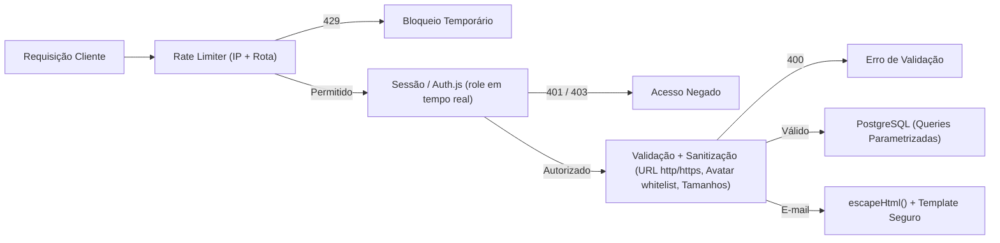

# Análise de Segurança e Plano de Correções — Vivências Superdotadas

> **Data da análise:** 2026-11-17  
> **Escopo:** Código-fonte em `src/`, configurações (`next.config.ts`, `.env.example`, `.github/workflows/ci.yml`) e suíte de testes (`tests/`).

---

## Resumo Executivo

A aplicação possui uma base arquitetural bem intencionada em pontos críticos (queries SQL parametrizadas, cálculo de preços no servidor, hashing de senhas com `bcryptjs` e verificação criptográfica de webhooks), mas apresenta **falhas críticas e de alta severidade** em controle de acesso, proteção de dados sensíveis (LGPD), validação de entrada e proteção contra abuso que devem ser corrigidas antes de operar em produção com dados reais de associados.

| Domínio de Segurança | Status Atual | Avaliação |
| :--- | :--- | :--- |
| **Banco de Dados & SQL Injection** | Consultas 100% parametrizadas | 🟢 Forte |
| **Pagamentos & Webhooks** | Preços no servidor + assinatura Stripe/MP (secret MP opcional) | 🟢 Bom |
| **Autenticação & Sessão** | Auth.js + `bcryptjs`, mas revogação de `role` não invalida JWT ativo | 🟡 Atenção |
| **Controle de Acesso (Autorização)** | `POST /api/memberships` permite sobrescrever usuários sem auth | 🔴 Crítico |
| **Validação de Entrada & XSS/HTML** | URLs sem validação de protocolo (`javascript:`) + HTML injection em e-mails | 🟠 Alto Risco |
| **Proteção contra Abuso (Rate Limit)** | Ausente em login, envio de e-mails e cadastros públicos | 🟠 Alto Risco |

---

## Parte 1 — Pontos Positivos (Boas Práticas Já Implementadas)

1. **Proteção contra SQL Injection**  
   Todas as consultas em `src/lib/db.ts` (`query()`, linhas 192–203) e nas rotas de API utilizam parâmetros posicionais (`$1, $2, ...`) do driver `pg`, sem interpolação direta de entradas do usuário.
2. **Integridade de Preços no Checkout**  
   Em `src/app/api/checkout/route.ts` (linhas 53, 105–120, 153, 196–213), o servidor ignora preços enviados pelo cliente, consulta `price_cents` em `DEFAULT_PRODUCTS` no backend e impõe limites (`Math.max` / `Math.min`) para quantidades (1 a 20) e doações (R$ 5 a R$ 50.000).
3. **Verificação de Webhooks e Idempotência**  
   - **Stripe** (`src/app/api/webhooks/stripe/route.ts`, linhas 17–23): valida a assinatura com `stripe.webhooks.constructEvent`.
   - **Mercado Pago** (`src/lib/mercadopago.ts`, linhas 14–40; `src/app/api/webhooks/mercadopago/route.ts`, linhas 51–85): verifica HMAC-SHA256 com `crypto.timingSafeEqual`, consulta a API oficial do Mercado Pago (`paymentApi.get`) como fonte da verdade e garante idempotência via `ON CONFLICT (stripe_session_id) DO NOTHING`.
4. **Senhas com Hash**  
   Uso de `bcryptjs` (custo 10) no cadastro (`src/app/api/auth/register/route.ts`, linha 32) e `bcrypt.compare` na autenticação (`src/lib/auth.ts`, linha 116).
5. **Cabeçalhos HTTP e Pipeline de CI**  
   Configuração de `X-Content-Type-Options: nosniff`, `X-Frame-Options: DENY`, `Referrer-Policy` e `Permissions-Policy` em `next.config.ts` (linhas 10–22), além de verificação de arquivos `.env` commitados e `npm audit --audit-level=high` em `.github/workflows/ci.yml` (linhas 57–78).

---

## Parte 2 — Vulnerabilidades e Pontos de Melhoria Identificados

### 🔴 Severidade Crítica

#### 1. Sobrescrita Não Autenticada de Contas e Associações (Broken Access Control / IDOR)
- **Localização:** `src/app/api/memberships/route.ts` (linhas 6–139)
- **Descrição:** A rota `POST /api/memberships` **não exige autenticação** e confia integralmente no campo `body.email` enviado no JSON:
  - Busca `SELECT id FROM users WHERE LOWER(email) = $1` (linhas 36–41).
  - Se existir ficha em `memberships` com aquele e-mail, executa `UPDATE memberships` sobrescrevendo nome, perfil, cidade/UF, avatar, manifesto e status de laudo (linhas 57–85).
  - Se existir usuário em `users`, executa `UPDATE users SET name = $1, avatar_config = $2, neurodivergences = $3, manifesto = $4, has_medical_report = $5 WHERE id = $6` (linhas 108–113).
  - Se um usuário autenticado informar o e-mail de outra pessoa que possui ficha sem `user_id`, o fallback `else if ((session?.user as { id?: string } | undefined)?.id)` (linhas 42–46) vincula o `user_id` do atacante à ficha da vítima.
- **Impacto:** Qualquer pessoa anônima pode alterar dados de perfil/avatar/manifesto/laudo de qualquer usuário ou administrador conhecido, ou sequestrar fichas de associação de terceiros.

#### 2. Vinculação Automática por E-mail sem Verificação (Pre-Account Takeover & Exposição LGPD)
- **Localização:** `src/app/api/auth/register/route.ts` (linhas 34–66) e `src/lib/auth.ts` (`syncAvatarFromMembership`, linhas 15–56)
- **Descrição:** O cadastro via e-mail e senha não verifica posse do e-mail (token/link de confirmação), mas copia imediatamente `avatar_config`, `neurodivergences`, `manifesto` e `has_medical_report` (dado sensível de saúde sob a LGPD) de `memberships` para o novo usuário e vincula `memberships.user_id`. O login `Credentials` (`authorize`, linha 119) também dispara `syncAvatarFromMembership`.
- **Impacto:** Caso alguém tenha enviado uma ficha em `/associe-se` antes de criar conta, um terceiro que registrar o mesmo e-mail primeiro assume a associação e acessa dados sensíveis no `/perfil`.

---

### 🟠 Severidade Alta

#### 3. HTML Injection em E-mails e Relay de Phishing
- **Localização:** `src/lib/email.ts` (`buildVivenciasTemplate`, linhas 13–81) e chamadas em `src/app/api/auth/register/route.ts` (linhas 68–79), `src/app/api/memberships/route.ts` (linhas 116–128), `src/app/api/professionals/route.ts` (linhas 82–93), `src/app/api/community/route.ts` (linhas 95–101) e `src/app/api/admin/route.ts` (linhas 80–88, 211–219).
- **Descrição:** `heading`, `intro`, `ctaLabel`, `ctaUrl` e valores interpolados em `bodyHtml` (`name`, `profile`, `specialty`, `title`, `memberNumber`) são inseridos diretamente no HTML sem escape de caracteres (`<`, `>`, `"`, `&`).
- **Impacto:** Endpoints públicos enviam e-mails para qualquer endereço informado em `body.email` com HTML arbitrário injetável a partir de campos como `name` ou `specialty`, permitindo phishing usando o remetente SMTP oficial da associação.

#### 4. Stored XSS via URLs `javascript:` e Moderação Cega no Painel Admin
- **Localização:**
  - `src/app/api/community/route.ts` (linhas 56–57) e `src/app/comunidade/ComunidadeClient.tsx` (linhas 258–292)
  - `src/app/api/professionals/route.ts` (linhas 43–47) e `src/app/profissionais/ProfissionaisClient.tsx` (linhas 492–503)
  - `src/app/admin/page.tsx` (linhas 30–35), `src/app/api/admin/route.ts` (linhas 35–38) e `src/app/admin/AdminClient.tsx` (linhas 348–515)
- **Descrição:**
  1. Os campos `externalUrl`, `imageUrl`, `socialUrl`, `contactUrl` e `eventLink` não validam se o protocolo é `http:` ou `https:`.
  2. Na tela `/admin`, os cards de moderação de profissionais e submissões da comunidade **não exibem** `social_url`, `contact_url`, `external_url` nem `image_url` antes da aprovação.
- **Impacto:** Um atacante pode submeter `socialUrl: "javascript:..."` ou `externalUrl: "javascript:..."`; o administrador aprova sem visualizar o link oculto, expondo visitantes a Stored XSS ao clicarem no link publicado.

#### 5. Ausência de Rate Limiting
- **Localização:** Rotas `src/app/api/**` e autenticação em `src/app/api/auth/[...nextauth]/route.ts`.
- **Descrição:** Não há limitação de requisições por IP para login por senha, criação de contas, envio de formulários com disparo de SMTP (`/api/auth/register`, `/api/memberships`, `/api/professionals`) ou geração de sessões de checkout (`/api/checkout`).
- **Impacto:** Risco de força bruta contra senhas e `ADMIN_PASSWORD`, esgotamento de cota SMTP e poluição do banco de dados.

---

### 🟡 Severidade Média

#### 6. Revogação de Admin não Atualiza Sessão JWT Ativa
- **Localização:** `src/lib/auth.ts` (`jwt` linhas 148–169 e `session` linhas 170–199)
- **Descrição:** `token.role` é gravado apenas no login (`if (user)`). O callback `session` consulta o banco para atualizar `membershipStatus`, mas não consulta `users.role`.
- **Impacto:** Um administrador rebaixado no painel continua com `role === "admin"` até o cookie JWT expirar.

#### 7. Verificação de Assinatura Opcional no Webhook do Mercado Pago
- **Localização:** `src/app/api/webhooks/mercadopago/route.ts` (linhas 28–39) e `.env.example`
- **Descrição:** `verifyMercadoPagoSignature` só executa `if (webhookSecret)`, e `MERCADOPAGO_WEBHOOK_SECRET` não está documentada em `.env.example`.
- **Impacto:** Em produção sem a variável configurada, notificações sem assinatura são aceitas pelo endpoint (dependendo apenas da consulta posterior à API do MP).

#### 8. Comparação de `ADMIN_PASSWORD` sem Tempo Constante e E-mail Admin Hardcoded
- **Localização:** `src/lib/auth.ts` (linhas 58, 101–105), `src/app/api/admin/route.ts` (linha 160) e `src/app/admin/AdminClient.tsx` (linha 669)
- **Descrição:** `password === envAdminPass` usa comparação simples de strings e `MASTER_ADMIN_EMAIL = "ghcastellano@gmail.com"` está fixo no código-fonte.

#### 9. Ausência de Validação de Schema e Limites de Payload
- **Localização:** Rotas `POST` em `src/app/api/**`, `src/app/avatar/page.tsx` (linhas 11–24) e `src/lib/avatar.ts` (linhas 182–206)
- **Descrição:** Campos como `content`, `title`, `otherQualifications` e o JSON `avatarConfig` (no banco e no parâmetro `?c=` em base64 de `/avatar`) não possuem validação de schema, whitelist de opções nem limites máximos de tamanho antes da gravação ou renderização de SVG via `dangerouslySetInnerHTML` (`src/components/AvatarDisplay.tsx`, linha 51).

---

### 🔵 Baixa Severidade, LGPD e Hardening

10. **Ausência de `Content-Security-Policy` (CSP) e `Strict-Transport-Security` (HSTS)** em `next.config.ts`.
11. **Política de senha mínima de 6 caracteres** (`src/app/api/auth/register/route.ts`, linha 20; `src/app/entrar/page.tsx`, linha 220) e resposta `409` que permite enumeração simples de e-mails cadastrados.
12. **Consentimento explícito de exposição pública (LGPD)** para profissionais em `src/app/profissionais/ProfissionaisClient.tsx`, uma vez que `GET /api/professionals` expõe `email`, `whatsapp` e `registry_code` publicamente após aprovação.
13. **DDL em runtime (`ensureSchema`)** em `src/lib/db.ts` (linhas 28–190), que exige permissões de `CREATE/ALTER TABLE` na aplicação em produção; recomendável migrar gradualmente para scripts de migração dedicados.

---

## Parte 3 — Plano de Implementação das Correções

### Decisões que Exigem Confirmação Antes da Execução

> [!IMPORTANT]
> **Fluxo autenticado em `/associe-se` (`POST /api/memberships`):** exigir sessão autenticada e usar exclusivamente `session.user.email`. Visitantes deslogados continuam acessando `/associe-se` (HTTP 200) e usando o Estúdio de Avatar com rascunho preservado em `sessionStorage`, sendo orientados a entrar/criar conta em `/entrar` para enviar a solicitação.

> [!WARNING]
> **Variável `MERCADOPAGO_WEBHOOK_SECRET`:** passará a ser obrigatória quando `NODE_ENV === "production"` (`503` se ausente). Garantir que esteja configurada na Vercel antes do deploy.

> [!NOTE]
> **Questões em aberto para alinhamento:**
> 1. Remover `MASTER_ADMIN_EMAIL` hardcoded (`ghcastellano@gmail.com`) para depender apenas de `ADMIN_EMAILS` / `MASTER_ADMIN_EMAIL` via env, ou manter o fallback no código?
> 2. Subir a senha mínima de novos cadastros de `6` para `8` caracteres?

---

### Arquivos a Criar e Modificar

#### 1. Utilitários Centrais (`src/lib/security.ts` e `src/lib/rate-limit.ts`)
- **`[NEW] src/lib/security.ts`**:
  - `escapeHtml(value)` para escapar `& < > " '`.
  - `sanitizeHttpUrl(raw)` permitindo apenas `http:` e `https:`.
  - `sanitizeRelativeOrHttpUrl(raw)` permitindo caminhos relativos (`/`) ou `http:`/`https:`.
  - `timingSafeEqualStrings(a, b)` usando SHA-256 + `crypto.timingSafeEqual`.
  - `isValidEmail(email)` e `clampString(value, maxLen)`.
- **`[NEW] src/lib/rate-limit.ts`**:
  - Rate limiter *sliding-window* em memória por `(bucket, ip)` com limpeza de expirados, extração de IP (`getClientIp`) e helper `rateLimitResponse(retryAfterSeconds)` (HTTP `429` + `Retry-After`).

#### 2. Sanitização de Avatares (`src/lib/avatar.ts` e `src/app/avatar/page.tsx`)
- **`[MODIFY] src/lib/avatar.ts`**: adicionar `sanitizeAvatarConfig()` (whitelist contra `AVATAR_OPTIONS` e `seed` limitado a 64 chars) e `sanitizeNeurodivergences()` (whitelist contra `NEURODIVERGENCE_BADGES`), aplicados em `renderAvatarSvg()` e `renderShareableAvatarSvg()`; escapar `'` em `escapeXml()`.
- **`[MODIFY] src/app/avatar/page.tsx`**: limitar tamanho do parâmetro `sp.c` (máx. 2 KB), `sp.name` (80 chars) e `sp.m` (240 chars) e aplicar os sanitizadores.

#### 3. Autenticação e Sessão (`src/lib/auth.ts`, `src/app/api/auth/[...nextauth]/route.ts`, `src/app/api/auth/register/route.ts`, `src/app/entrar/page.tsx`)
- **`[MODIFY] src/lib/auth.ts`**:
  - Atualizar `role` a partir do banco (`users.role` + `isAdminEmail`) dentro do callback `session` (exceto `env-admin`).
  - Remover `syncAvatarFromMembership` de `Credentials` (`authorize`) e mantê-lo apenas no OAuth Google quando `profile?.email_verified === true`.
  - Usar `timingSafeEqualStrings` para `ADMIN_PASSWORD`.
- **`[MODIFY] src/app/api/auth/[...nextauth]/route.ts`**: aplicar rate limiting em `POST` para `/callback/credentials` (ex.: 15 req / 5 min por IP).
- **`[MODIFY] src/app/api/auth/register/route.ts`**: aplicar rate limit (5 req / 15 min por IP), validar e-mail, limitar senha (mín. 8 / máx. 128 chars) e **remover** cópia/vinculação automática de `memberships` durante cadastro por senha não verificado.
- **`[MODIFY] src/app/entrar/page.tsx`**: alinhar `minLength` e placeholder da senha.

#### 4. Associações (`/api/memberships` e `/associe-se`)
- **`[MODIFY] src/app/api/memberships/route.ts`**: exigir `session?.user?.email` (`401` se não autenticado), derivar `email` exclusivamente da sessão, aplicar rate limit, validar enums (`profile`, `hasMedicalReport`), sanitizar `avatarConfig`/`neurodivergences` e limitar textos.
- **`[MODIFY] src/app/associe-se/page.tsx` e `src/app/associe-se/AssocieSeClient.tsx`**: informar `isAuthenticated`, travar o e-mail da sessão quando autenticado, manter o Estúdio de Avatar interativo com rascunho em `sessionStorage` para visitantes e exibir CTA de login antes da submissão formal.

#### 5. E-mails, Comunidade, Profissionais, Eventos, Admin e Pagamentos
- **`[MODIFY] src/lib/email.ts`** e callers (`register`, `memberships`, `professionals`, `community`, `admin`): escapar com `escapeHtml()` todos os campos dinâmicos (`heading`, `intro`, `ctaLabel`, parâmetros de `bodyHtml`) e validar `ctaUrl` via `sanitizeHttpUrl()`.
- **`[MODIFY] src/app/api/community/route.ts` e `src/app/comunidade/ComunidadeClient.tsx`**: rate limit, whitelist de `kind`, limites de comprimento, validação `http(s)` no servidor (`400`) e checagem defensiva no cliente.
- **`[MODIFY] src/app/api/professionals/route.ts` e `src/app/profissionais/ProfissionaisClient.tsx`**: rate limit, validação `http(s)` de `socialUrl`/`contactUrl`, checkbox obrigatório de consentimento público LGPD validado no servidor e proteção nos links do cliente.
- **`[MODIFY] src/app/eventos/page.tsx`**: validar `event_link` e `image_url` antes de renderizar.
- **`[MODIFY] src/app/admin/page.tsx`, `src/app/api/admin/route.ts` e `src/app/admin/AdminClient.tsx`**: exibir `social_url`, `contact_url`, `whatsapp`, `external_url` e `image_url` na fila de moderação do `/admin`; validar URLs de eventos, categorias de despesas, valores positivos finitos e e-mails em `set_user_role`.
- **`[MODIFY] src/app/api/checkout/route.ts`**: rate limit por IP e validação estrita (`Number.isFinite`) de `amountReais`.
- **`[MODIFY] src/app/api/webhooks/mercadopago/route.ts` e `.env.example`**: exigir `MERCADOPAGO_WEBHOOK_SECRET` em produção e documentar variáveis do Mercado Pago e `MASTER_ADMIN_EMAIL`.

#### 6. Cabeçalhos HTTP (`next.config.ts`)
- **`[MODIFY] next.config.ts`**: adicionar `Content-Security-Policy` compatível com Next.js App Router, fontes auto-hospedadas, avatares SVG (`data:`/`blob:`), imagens HTTPS e redirecionamento Google OAuth (`form-action 'self' https://accounts.google.com`), além de `Strict-Transport-Security` e `upgrade-insecure-requests` apenas quando `process.env.NODE_ENV === "production"`.

---

### Plano de Verificação
1. **Testes unitários (`tests/unit.test.mjs`)**: cobrir `escapeHtml`, `sanitizeHttpUrl`, `sanitizeAvatarConfig`, `checkRateLimit` e `verifyMercadoPagoSignature`.
2. **Testes de integração (`tests/run-tests.mjs`)**: validar `401` em `POST /api/memberships` sem autenticação, `400` para URLs `javascript:` e senhas inválidas, e presença dos cabeçalhos CSP/segurança.
3. **Validação completa**: executar `npx tsc --noEmit`, `npm run build`, `node --test tests/unit.test.mjs`, `node --test tests/run-tests.mjs` e `node tests/e2e-playwright.mjs`.
